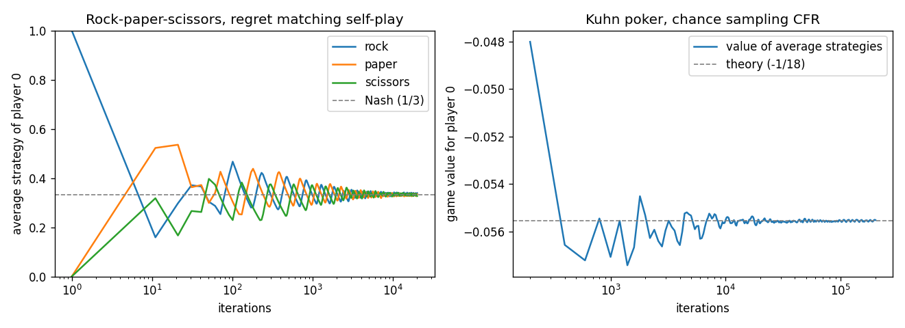
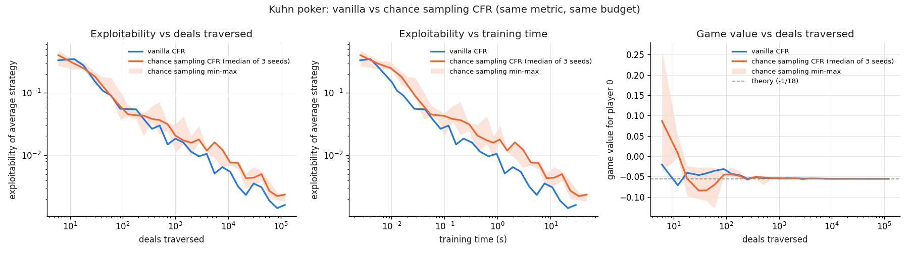
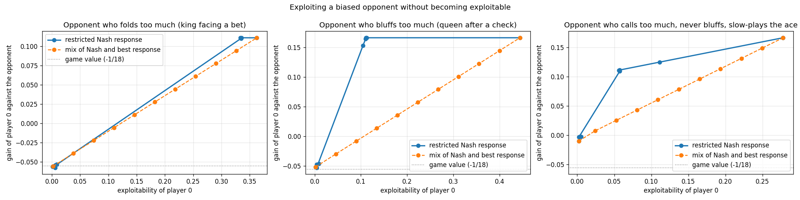

# learning-bluff

Learning to bluff with regret minimization.

I'm implementing from scratch the algorithms used to find Nash equilibria in
imperfect information games. Started with rock-paper-scissors, now Kuhn poker.



## What's in there

- **Rock-paper-scissors + regret matching**: the agent exploits a fixed opponent,
  and in self-play the average strategy converges to (1/3, 1/3, 1/3).
- **Kuhn poker + CFR** (vanilla and chance sampling): game value converges to -1/18,
  the exploitability of the average strategy goes to 0, and the strategies match the
  known equilibrium (queen bluffs, ace bets 3*alpha, etc.,
  see [figures/kuhn_strategy.md](figures/kuhn_strategy.md)).



- **Restricted Nash Response**: against a biased opponent, player 0 trains against a mix
  "biased opponent with probability p, adaptive opponent with probability 1 - p".
  Sweeping p traces the trade-off between gain against that opponent and exploitability;
  RNR gets most of the best response's gain for a fraction of its exploitability, and beats
  the naive mix of Nash and best response.



```
games/      rps.py, kuhn.py (rules, payoffs, infoset keys)
agents/     regret_matching.py (RegretMatcher, FixedAgent, InfoSetNode)
training/   rps_training.py, cfr_training.py, evaluation.py (exploitability)
evaluation/ exploitability via best response
tests/      pytest tests (game rules + convergence)
experiments/
  convergence.py   -> figures/convergence.png
  compare_cfr.py   -> figures/cfr_comparison.png, figures/kuhn_strategy.md
  rnr.py           -> figures/rnr.png
  results.ipynb    runs all three and shows the figures
figures/    plots
```

## Setup

Python 3.10+

```bash
python -m venv .venv
.venv\Scripts\activate        # Windows
# source .venv/bin/activate   # macOS / Linux
pip install -r requirements.txt
```

## Tests

```bash
python -m pytest
```

The CFR test on Kuhn runs 200k iterations, takes ~30s. To see the learned
strategy for each infoset:

```bash
python -m pytest tests/test_chance_sampling_cfr.py -s
```

## Figures

From the repo root:

```bash
python experiments/convergence.py
python experiments/compare_cfr.py [--deals 120000] [--seeds 3]
python experiments/rnr.py
```

Or open `experiments/results.ipynb` and run all cells (a few minutes).

## Kuhn poker

3 cards (queen < king < ace), one card each, ante of 1.
Each player can pass/check (`p`) or bet/call (`b`).
An infoset key like `"0pb"` means: I hold the queen, history is check then bet.

At equilibrium player 1 (the second player) wins 1/18 per hand on average, so
going first is a disadvantage even with perfect play.
